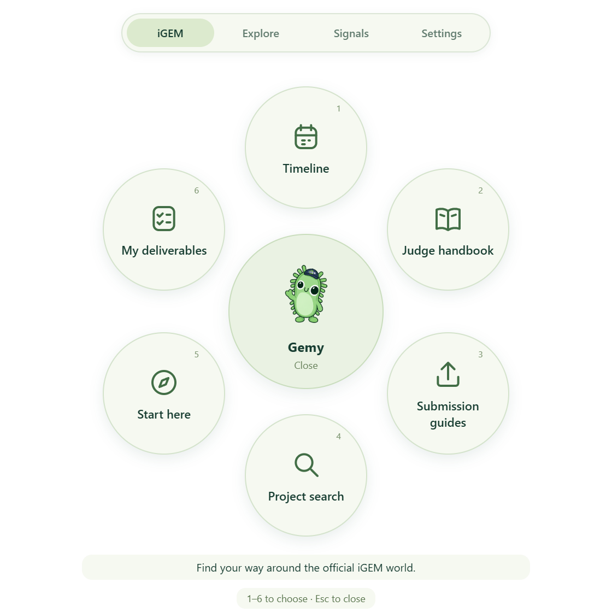
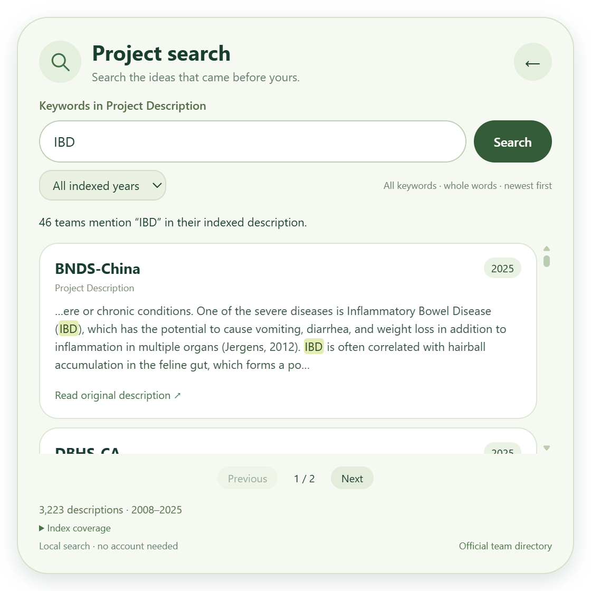

# iGEM Ping

[简体中文](README.zh-CN.md)

A desktop companion for iGEMers, with official competition links and keyword search across indexed Project Description pages.



## What it does

- Click Gemy once to open the wheel and again to close it. Drag it anywhere in the desktop work area; it stays on screen and gently rebounds into place at an edge.
- The default **iGEM** navigation offers **Timeline**, **Judge handbook**, **Submission guides**, **Project search**, **Start here**, and **My deliverables**.
- **Explore** adds 12 official links across pages, including **Medal criteria**, **Special awards**, Wiki editing and uploads, and project archives.
- **Signals** offers six local pings: **Need a hand**, **New idea**, **Check this**, **It worked!**, **Focus time**, and **Take a break**.
- **Settings** contains language, sound, reduced motion, companion size, a 25-minute focus toggle, and quit.
- English is the default language; Simplified Chinese is available. Preferences are saved on your computer.

This is an independent community project for everyone in iGEM. It is not an official iGEM application or an endorsement by the iGEM Foundation. Artwork sources and terms are listed in [ASSETS.md](ASSETS.md).

## Run on Windows

Download the portable `iGEM-Ping-<version>-win-x64.exe` from this repository's **Releases** page, then open it. The portable build does not need an installer. Builds are unsigned, so Windows may show a publisher or SmartScreen notice.

The packaged target is Windows x64. macOS and Linux builds are not provided or tested.

## Controls

- **Ctrl + Alt + G:** open the wheel at the cursor, starting with official navigation.
- **Ctrl + Alt + P:** show or hide the companion.
- **Drag the companion:** move it. Release near a screen edge to dock with a small inward rebound. Reduced motion disables the rebound.
- **Click Gemy:** toggle the navigation wheel. The wheel leaves the companion accessible.
- **Right-click Gemy:** open the **Settings** wheel.
- **Tray menu:** access the wheel or quit.

Choose an official shortcut to open its page in your default browser. Use **Explore** to browse the additional links, **Signals** for local animations, or **Settings** to change settings. The **1–6** keys select an item on the current wheel page, and **Esc** closes the wheel. If another application already owns a shortcut, use Gemy or the tray menu.

In **Settings**, the focus control starts a 25-minute session or ends the current session. Gemy shows the countdown and a break ping appears when time is up. Quitting the app ends the session.

Pings appear locally. People watching a whole-screen share can see them; sharing only another application's window does not include the overlay. There are no shared rooms or pings sent to teammates. Exclusive fullscreen applications may cover the overlay.

## Official navigation

The six default shortcuts appear in this order:

1. **Timeline:** [competition deliverables and deadlines](https://competition.igem.org/deliverables/).
2. **Judge handbook:** [the official judging handbook](https://competition.igem.org/judging/handbook), covering the judging process and reference material for judges.
3. **Submission guides:** [public deliverable guides](https://competition.igem.org/deliverables/guides), so you can read the instructions before signing in.
4. **Project search:** search the bundled Project Description index inside the app. Its **Official team directory** button opens the [all-years directory](https://teams.igem.org/list?year=all).
5. **Start here:** [the official starting-a-team guide](https://competition.igem.org/about/starting-a-team).
6. **My deliverables:** [your team's deliverables dashboard](https://teams.igem.org/go/deliverables), where you can check submission status and deadlines after signing in and selecting your team.

The **Explore** wheel also offers [Wiki getting started](https://teams.igem.org/go/deliverables/wiki/getting-started) and [Wiki asset uploads](https://teams.igem.org/go/deliverables/wiki/uploads), both requiring an iGEM login and team selection, plus [Video Universe](https://video.igem.org/) for video and audio. Uploading media requires the appropriate account access. [Phoenix project search](https://community.igem.org/projects/phoenix-project) is another source of inspiration, with coverage through **2022** only; use the all-years directory for later teams.

Uploading a wiki asset and submitting a competition deliverable are separate steps. Wiki source belongs in your team's iGEM GitLab repository; images, documents, and fonts use Wiki Uploads; video and audio use Video Universe. Follow the relevant official guide for each submission.

These shortcuts open the live official websites. **Timeline** opens public requirements and dates; **My deliverables** opens your team's status page in the browser. The app does not sign in for you, read your team's dashboard, or synchronize your submission status.

## Project Description search



The 0.3.0 snapshot includes **3,223 descriptions from 2008–2025**. Coverage is partial, especially in early years; 2026 is not yet included.

Open **Project search** in the main wheel and type a keyword such as **IBD**. Results list the team, year, a highlighted passage from its indexed Project Description, and a button to read the original official wiki. You can filter by year and page through results.

Search is local and needs no account or API key. It matches all entered keywords, case-insensitively; Latin keywords use whole-word matching, so IBD does not accidentally match the gene name ribD. It does not infer synonyms or translate queries. A mention is evidence that a description discusses the term, not a claim that the term is the team's main research topic.

The bundled index is a dated snapshot, **not a complete archive of every team**. **Index coverage** shows the actual years and indexed team counts. Missing pages, unfilled templates and unavailable years are excluded, not treated as negative results. The index searches Description body text, not team-directory metadata, project abstracts substituted for descriptions, or the entire wiki. Sources, limitations and rebuild instructions are in [data/README.md](data/README.md).

The Explore wheel also opens the official [medal criteria](https://competition.igem.org/judging/awards/medals) and [special-award criteria](https://competition.igem.org/judging/awards/special).

## Privacy

The application does not require an account, collect telemetry, or make background network requests. Preferences stay in Electron's local user-data directory on your computer. Opening an official resource deliberately launches its HTTPS page in your browser; that website's login requirements and privacy practices then apply. Browser sign-in stays in your browser.

Installing development dependencies, rebuilding the project index, and downloading releases use the relevant public websites. User searches are not sent to a server.

## Build from source

Use Node.js 22 and npm on Windows. From the repository directory:

```powershell
npm ci
npm start
```

Run the checks and create the portable build:

```powershell
npm test
npm run test:smoke
npm run dist
```

The executable is written to `release/iGEM-Ping-<version>-win-x64.exe`. The smoke test starts the Electron application, so run it in a desktop session.

The app uses Electron with plain JavaScript, HTML, and CSS. No native input-hook helper is required: the wheel opens through a registered shortcut rather than intercepting a modifier-and-mouse gesture. Useful upstream references are Electron's [global shortcuts](https://www.electronjs.org/docs/latest/api/global-shortcut), [screen coordinates](https://www.electronjs.org/docs/latest/api/screen), and [transparent-window interactions](https://www.electronjs.org/docs/latest/tutorial/custom-window-interactions).

## Releases and contributions

Pull requests run the Windows checks in GitHub Actions. To release, update the version in `package.json` and `package-lock.json`, commit it, and push a matching `v<version>` tag. The release workflow tests the app, builds the portable executable, and attaches it to a GitHub release.

Bug reports are welcome. Include the app version, Windows version, display scaling, and steps to reproduce. Keep personal data out of screenshots and logs.

## Credits and license

The desktop ping interaction was inspired by [darrenprx/lolPing](https://github.com/darrenprx/lolPing). This project has its own implementation and does not copy lolPing code or League of Legends artwork or sounds.

The source code is available under the [MIT license](LICENSE). Official iGEM logos, mascots, and other third-party artwork are excluded from the code license; consult [ASSETS.md](ASSETS.md) before reusing them. [iGEM](https://igem.org/) names and marks belong to their respective rights holders.
