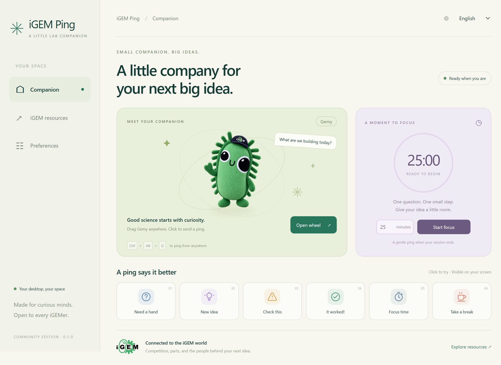

# iGEM Ping

[简体中文](README.zh-CN.md)

A little desktop companion for iGEMers. Keep the iGEM mascot Gemy nearby, drop a quick visual ping on your desktop, and take a timed focus break between ideas.



## What it does

- Six local pings: **Help**, **Idea**, **Caution**, **Success**, **Focus**, and **Break**.
- A floating companion you can drag around your desktop.
- A ping wheel at your cursor, plus a tray menu for quick access.
- A focus timer from 1 to 180 minutes.
- English by default, with a Simplified Chinese option.
- Sound, reduced motion, and companion size preferences, saved on your computer.
- Shortcuts to official iGEM resources in your default browser.

This is an independent community project for everyone in iGEM. It is not an official iGEM application or an endorsement by the iGEM Foundation. Artwork sources and terms are listed in [ASSETS.md](ASSETS.md).

## Run on Windows

Download the portable `iGEM-Ping-<version>-win-x64.exe` from this repository's **Releases** page, then open it. The portable build does not need an installer. Builds are unsigned, so Windows may show a publisher or SmartScreen notice.

The packaged target is Windows x64. macOS and Linux builds are not provided or tested.

## Controls

- **Ctrl + Alt + G:** open the ping wheel at the cursor.
- **Ctrl + Alt + P:** show or hide the companion.
- **Drag the companion:** move it.
- **Right-click the companion:** open settings.
- **Tray menu:** open settings, access the wheel, or quit.

Choose a ping from the wheel to place its animation on your desktop. Use the focus timer in settings to start a session. If another application already owns a shortcut, use the companion or tray controls.

Pings appear locally. People watching a whole-screen share can see them; sharing only another application's window does not include the overlay. There are no shared rooms or pings sent to teammates. Exclusive fullscreen applications may cover the overlay.

## Privacy

The application does not collect telemetry or make background network requests. Preferences stay in Electron's local user-data directory on your computer. Opening an official resource deliberately launches its HTTPS page in your browser; that website's own privacy practices then apply.

Installing development dependencies and downloading releases use npm and GitHub as usual.

## Build from source

Use Node.js 22 and npm on Windows. From the repository directory:

```powershell
npm ci
npm start
```

Run the checks and create the portable build:

```powershell
npm test
npm run test:smoke
npm run dist
```

The executable is written to `release/iGEM-Ping-<version>-win-x64.exe`. The smoke test starts the Electron application, so run it in a desktop session.

The app uses Electron with plain JavaScript, HTML, and CSS. No native input-hook helper is required: the wheel opens through a registered shortcut rather than intercepting a modifier-and-mouse gesture. Useful upstream references are Electron's [global shortcuts](https://www.electronjs.org/docs/latest/api/global-shortcut), [screen coordinates](https://www.electronjs.org/docs/latest/api/screen), and [transparent-window interactions](https://www.electronjs.org/docs/latest/tutorial/custom-window-interactions).

## Releases and contributions

Pull requests run the Windows checks in GitHub Actions. To release, update the version in `package.json` and `package-lock.json`, commit it, and push a matching `v<version>` tag. The release workflow tests the app, builds the portable executable, and attaches it to a GitHub release.

Bug reports are welcome. Include the app version, Windows version, display scaling, and steps to reproduce. Keep personal data out of screenshots and logs.

## Credits and license

The desktop ping interaction was inspired by [darrenprx/lolPing](https://github.com/darrenprx/lolPing). This project has its own implementation and does not copy lolPing code or League of Legends artwork or sounds.

The source code is available under the [MIT license](LICENSE). Official iGEM logos, mascots, and other third-party artwork are excluded from the code license; consult [ASSETS.md](ASSETS.md) before reusing them. [iGEM](https://igem.org/) names and marks belong to their respective rights holders.
