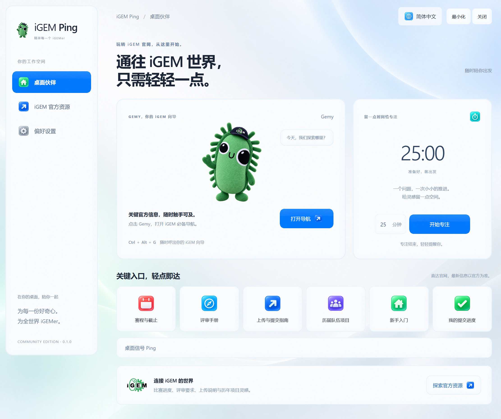

# iGEM Ping

[English](README.md)

送给每一位 iGEMer 的桌面小伙伴。让 iGEM 吉祥物 Gemy 陪在桌边，从桌面轮盘找到需要的官方页面，也给专注和休息留一点时间。



## 功能

- 默认的 **iGEM 新手导航**轮盘提供六项官方入口：**赛程与截止、评审手册、上传与提交指南、历届队伍项目、新手入门、我的提交进度**。
- 切换至**协作信号**模式，可使用六种本地信号：**来帮个忙、有个想法、注意这里、有结果啦、专注一下、休息一下**。
- 可拖动的桌面小伙伴。
- 在鼠标位置打开的桌面轮盘，以及快捷托盘菜单。
- 1–180 分钟的专注计时器。
- 默认英文，可切换简体中文。
- 声音、减少动态效果和小伙伴大小设置，保存在本机。
- 在默认浏览器中打开 iGEM 官方资源。
- 图标、背景、面板和按钮采用整套 ImageGen 生成的 iOS 风格 PNG 皮肤。文字保留为真实文本，控件保留可访问名称与键盘操作。

这是面向所有 iGEMer 的独立社区项目，并非 iGEM 官方应用，也不代表 iGEM Foundation 的认可。素材来源与使用条款见 [ASSETS.md](ASSETS.md)。

## 在 Windows 上运行

从本仓库的 **Releases** 页面下载 `iGEM-Ping-<版本号>-win-x64.exe`，打开即可运行，无需安装。便携版尚未进行代码签名，Windows 可能显示发布者或 SmartScreen 提示。

当前提供 Windows x64 构建。macOS 和 Linux 尚未提供构建，也未经测试。

## 操作

- **Ctrl + Alt + G：**在鼠标位置打开轮盘，默认显示官方导航。
- **Ctrl + Alt + P：**显示或隐藏小伙伴。
- **拖动小伙伴：**移动位置。
- **右键点击小伙伴：**打开设置。
- **托盘菜单：**打开设置、使用轮盘或退出。

点击小伙伴打开 **iGEM 新手导航**，选择官方入口后，会在默认浏览器中打开对应页面。切换至**协作信号**模式，可在桌面显示本地动画。按 **1–6** 选择当前模式中的项目，按 **Esc** 关闭轮盘。在设置中可以启动专注计时。如果快捷键已被其他程序占用，可使用小伙伴或托盘入口。

Ping 仅显示在本机。共享整个屏幕时，观看者可以看到它；仅共享其他应用的窗口时，不会包含桌面浮层。本项目没有联机房间，也不会向队友发送 Ping。独占全屏应用可能遮挡浮层。

## 官方导航

默认六项入口按以下顺序排列：

1. **赛程与截止：**[官方提交物与截止日期](https://competition.igem.org/deliverables/)。
2. **评审手册：**[官方评审手册](https://competition.igem.org/judging/handbook)，了解评审流程与评审员参考资料。
3. **上传与提交指南：**[公开提交指南](https://competition.igem.org/deliverables/guides)，无需先登录即可阅读说明。
4. **历届队伍项目：**[全年份队伍目录](https://teams.igem.org/list?year=all)，按队名、学校或地区查找，再进入团队 Wiki。
5. **新手入门：**[官方组队入门指南](https://competition.igem.org/about/starting-a-team)。
6. **我的提交进度：**[团队提交面板](https://teams.igem.org/go/deliverables)，登录 iGEM 账号并选择队伍后，可查看提交状态和截止事项。

资源页另有 [Wiki 编辑入门](https://teams.igem.org/go/deliverables/wiki/getting-started)和 [Wiki 素材上传](https://teams.igem.org/go/deliverables/wiki/uploads)，两者均需要登录并选择队伍；视频与音频入口为 [Video Universe](https://video.igem.org/)，上传时需要相应账号权限。[Phoenix 项目搜索](https://community.igem.org/projects/phoenix-project)可补充选题灵感，但仅收录至 **2022 年**；较新的队伍请使用全年份目录查找。

上传 Wiki 素材和正式提交比赛材料是两个步骤。Wiki 源码放在团队的 iGEM GitLab 仓库；图片、文档和字体使用 Wiki Uploads；视频与音频使用 Video Universe。各项正式提交请按照对应的官方指南操作。

这些快捷入口打开的是实时官方网页。“赛程与截止”指向公开的官方要求和日期；“我的提交进度”在浏览器中打开团队提交状态页面。应用不会代为登录、读取团队后台或同步提交状态。

## 隐私

应用本身无需账号，不收集遥测数据，不在后台发起网络请求。偏好设置保存在本机的 Electron 用户数据目录。只有主动打开官方资源时，才会在浏览器中访问对应的 HTTPS 页面；该网站自身的登录要求和隐私政策适用。登录会话留在浏览器中。

安装开发依赖和下载发行版仍会正常访问 npm 和 GitHub。

## 从源码运行

在 Windows 上准备 Node.js 22 和 npm，然后在仓库目录执行：

```powershell
npm ci
npm start
```

运行检查并构建便携版：

```powershell
npm test
npm run test:smoke
npm run dist
```

可执行文件输出到 `release/iGEM-Ping-<版本号>-win-x64.exe`。冒烟测试会启动 Electron 应用，需要在桌面会话中运行。

项目使用 Electron、原生 JavaScript、HTML 和 CSS。轮盘通过注册的快捷键打开，不拦截按住修饰键再拖动鼠标的全局手势，因此不需要原生输入钩子程序。实现参考 Electron 官方文档：[全局快捷键](https://www.electronjs.org/docs/latest/api/global-shortcut)、[屏幕坐标](https://www.electronjs.org/docs/latest/api/screen)、[透明窗口交互](https://www.electronjs.org/docs/latest/tutorial/custom-window-interactions)。

## 发布与贡献

Pull Request 会在 GitHub Actions 中运行 Windows 检查。发布时，更新 `package.json` 和 `package-lock.json` 中的版本号，提交后推送对应的 `v<版本号>` 标签。发布工作流会测试应用、生成便携版，并将其附加到 GitHub Release。

欢迎提交问题与改进。报告问题时，请附上应用版本、Windows 版本、显示缩放比例和复现步骤；截图和日志请避免包含个人信息。

## 致谢与许可

桌面 Ping 交互的灵感来自 [darrenprx/lolPing](https://github.com/darrenprx/lolPing)。本项目独立实现，未复制 lolPing 代码，也未使用《英雄联盟》的图片或音效。

源代码采用 [MIT 许可证](LICENSE)。iGEM 官方标志、吉祥物及其他第三方素材不在代码许可证的授权范围内；复用前请查阅 [ASSETS.md](ASSETS.md)。[iGEM](https://igem.org/) 名称与标志归相应权利人所有。
